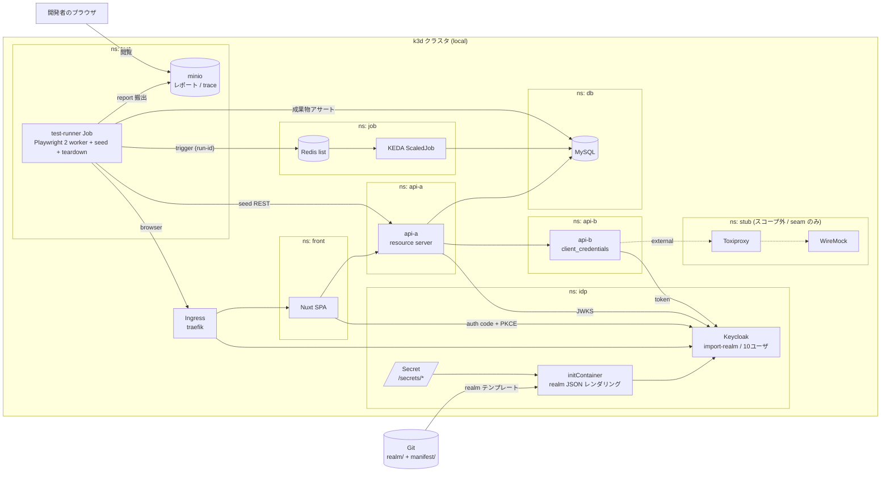

# k8s-test-harness-lab

k8s 上に構築するテストハーネスの技術検証。

**このリポジトリはラボである。** dev 環境へ持ち出すのは **マニフェストとパターンのみ**で、
サンプルアプリ (`app/`) は検証後に破棄する前提。製品の原型として参照しないこと。

## ドキュメント

| ファイル | 内容 |
| --- | --- |
| [doc/poc-acceptance.md](doc/poc-acceptance.md) | PoC の合格条件。これを満たしたら閉じる |
| [doc/implementation-plan.md](doc/implementation-plan.md) | 方針と Step 0〜7 |
| [doc/architecture.md](doc/architecture.md) | 構成図、採用技術、設計の決めごと |
| [doc/namespace-layout.md](doc/namespace-layout.md) | NameSpace 構成、ディレクトリ構成、overlay 差分 |
| [doc/local-cluster.md](doc/local-cluster.md) | ローカルクラスタの作成・削除、kubectl の context 切り替え |

## 検証対象

- **(1)** Keycloak を EKS 上にセルフホストし、Git の realm JSON で複数テストユーザを宣言的に管理する
- **(3)** テストデータ準備 / E2E / ScaledJob 起動を k8s Job として回す

(2) カオスエンジニアリング (Toxiproxy + WireMock) はスコープ外。seam のみ用意する。

## 構成図



実線が PoC の対象、破線が (2) 向けの seam。詳細は [doc/architecture.md](doc/architecture.md)。

## ローカルで動かす

前提: docker / k3d v5 / kubectl。手順の詳細と context の切り替えは [doc/local-cluster.md](doc/local-cluster.md)。

```sh
make cluster-up    # k3d クラスタ k8s-test-harness-lab を作成 (current-context は変えない)
make deploy        # manifest/overlays/local を適用
make verify        # NameSpace / ingress の到達性と Keycloak の issuer の一致を確認
make render        # local overlay のレンダリング結果を確認
make cluster-down  # 削除
```

Keycloak の管理コンソール: http://keycloak.localtest.me:8080/admin/ (`admin` / `admin`、local 専用のダミー値)

## 計画の扱い

doc は暫定。実装を読んで理解が進んだ時点で随時変更する。
実装と乖離したら doc を直す。計画との差分を正当化する作業はしない。
