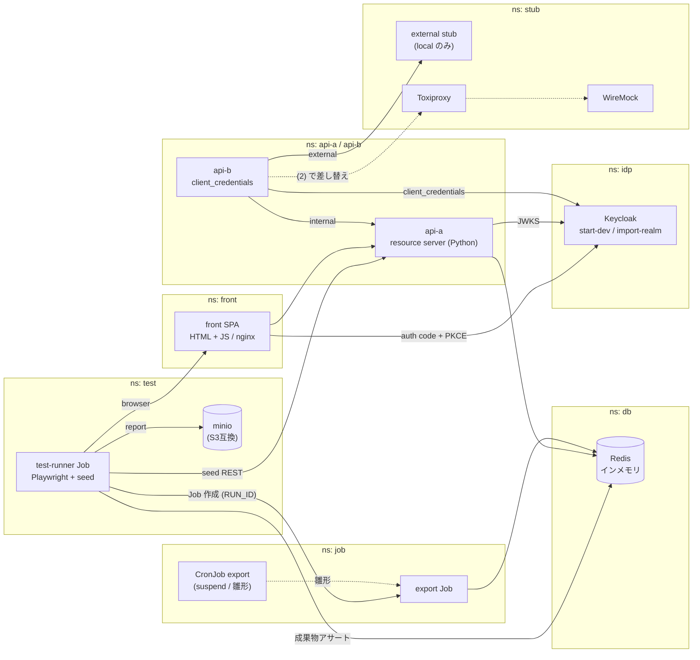

# 構成

## 全体図

実線が PoC の対象、破線が (2) 向けの seam。

## 採用技術

| 要素 | local (PoC) | dev (EKS) |
| --- | --- | --- |
| クラスタ | k3d | EKS (プラットフォームチーム管理) |
| IdP | Keycloak `start-dev --import-realm` / 1 replica / H2 (揮発) | 同じ |
| Ingress | traefik (k3d 標準) | ALB Controller |
| DB | Redis (in-cluster, インメモリ・永続化なし) | 実プロジェクトの DB (Aurora MySQL) |
| 後続 Job の起動 | 雛形 (suspend の CronJob) から Job を作成 | 実プロジェクト側の起動方式 (SQS / ファイル連携等) |
| レポート置き場 | minio | S3 |
| front | 素の HTML + JavaScript (oidc-client-ts) を nginx で配信 | — (サンプルアプリは持ち出さない) |
| api | Python 3.12 / FastAPI / PyJWT の resource server | — (サンプルアプリは持ち出さない) |

api を Python、DB を Redis、front を素の HTML + JS にしたのは、どれも検証対象ではなく軽さを優先したため (Step 3 / 4 で変更)。
DB は api-a / export Job / test-runner から共有するため、プロセス内の DB ではなく別 Pod にしている。
持ち出すのは「接続先を env で差し替える」パターンのみで、DB の銘柄は持ち出さない。

後続 Job は KEDA ScaledJob をやめ、普通の k8s Job にした (Step 6 で変更)。検証したいのは scaler の銘柄ではなく
「テストから Job を起動して成果物をアサートする型」だから。トリガ用のキューも置かない。

## 設計の決めごと

### issuer URL の一意性

ブラウザとクラスタ内 Pod の両方から **同一 URL** で Keycloak を解決できること。
詳細と local での解法は [implementation-plan.md](implementation-plan.md) の Step 2 を参照。

### Secret の契約

initContainer は常に `/secrets/*` を読んで realm JSON をレンダリングする。
**`/secrets` の埋め方だけが overlay 差分**になるようにし、local → dev の移植を patch 1枚で済ませる。

- local: ダミーの Secret マニフェスト (Git に入れてよい値のみ)
- dev: 既存実績のある Secrets Manager 注入方式

Keycloak (`idp`) の `/secrets` に置くキー:

| キー | 用途 |
| --- | --- |
| `admin-username` / `admin-password` | master realm の初期管理者 (`KC_BOOTSTRAP_ADMIN_*` に渡す) |
| `user-password-ci` | テストユーザ `ci-01`〜`ci-06` のパスワード |
| `user-password-human` | テストユーザ `human-01`〜`human-04` のパスワード |
| `api-b-client-secret` | クライアント `api-b` の secret。api-b 側の `/secrets/client-secret` と同じ値 |

### JWT の検証 (api-a)

| 項目 | 値 |
| --- | --- |
| issuer | `OIDC_ISSUER` (Keycloak の `KC_HOSTNAME` + `/realms/lab` と一致させる) |
| audience | `api-a`。トークンを発行するクライアントに audience mapper を付けて `aud` に入れる |
| 署名鍵 | issuer の discovery から `jwks_uri` を引いて取得 (クラスタ内から issuer URL で届く前提) |
| 時刻の許容幅 | `exp` / `iat` / `nbf` に 30 秒の leeway。Step 4 でブラウザ経由のトークンが `iat` 未来で一度だけ 401 になった (再現せず) |
| データの分離 | JWT の `sub`。他人の note は 404 (存在しないものとして扱う) |

realm のクライアント:

| clientId | 種別 | 用途 |
| --- | --- | --- |
| `test-runner` | public / password grant | 検証スクリプトと test-runner (Step 7)。`aud: api-a` を付ける |
| `front` | public / 認可コード + PKCE (S256 必須) | SPA。redirect URI と web origin は front のオリジンに限定。`aud: api-a` を付ける |
| `api-b` | confidential / client_credentials | api-b → api-a のサービス間通信。`aud: api-a` を付ける |

クライアントは用途ごとに分ける。1つにまとめるとブラウザ向けクライアントで password grant を有効にすることになり、
PKCE を必須にした意味が薄れる。分けておけば、環境ごとに `test-runner` だけを無効にできる。

`admin-cli` のトークンは `sub` も `aud: api-a` も持たないため、api-a は受け付けない。

realm テンプレート中の `{{secret:<キー>}}` が `/secrets/<キー>` の内容に、`{{config:<キー>}}` が `/config/<キー>` の内容に置換される。
`/config` は ConfigMap `keycloak-realm-params` (秘匿不要な環境差分。今は `FRONT_ORIGIN` のみ) から埋める。
Keycloak 自身の `${...}` 置換と混ざらないよう、記法を分けている。参照先のファイルが無い場合、initContainer は失敗する。

### ブラウザ向け設定の注入 (front)

front の静的ファイルは環境に依存させない。issuer / clientId / api-a の URL は nginx が `/config.js` として返し、
その値は ConfigMap `front-config` の環境変数から起動時に埋める。環境ごとにイメージをビルドし直さない。

api-a は `CORS_ALLOW_ORIGINS` に列挙したオリジンだけを CORS で許可する。

### run-id の全層伝播

test-runner が run-id を発行し、以下に伝播させる。

- HTTP: `X-Test-Run-Id` ヘッダ
- Job: env `RUN_ID` と Job 名 (`export-<run-id>`)
- DB: 保存するレコードに持つ (api-a は note の `run_id` フィールド)
- アプリログ: MDC 等に載せる

失敗時の調査コストが桁で変わるため、Step 3 の時点で入れる。

### 外部呼び出しの seam

api-b の外部連携先 URL を `EXTERNAL_BASE_URL` (ConfigMap) から差し替え可能にしておく。
local では外部の代わりに `stub/external` (nginx で固定 JSON を返す) に向ける。これは local overlay にだけ置く。
(2) を導入するときは `EXTERNAL_BASE_URL` を Toxiproxy に向け、`api-b → Toxiproxy → WireMock` の順に挟むだけで済む。

### サービス間認証 (api-b → api-a)

- api-b は confidential クライアント `api-b` の client_credentials でトークンを取り、期限の 30 秒前まで使い回す
- client secret は api-b の `/secrets/client-secret` から読む (Keycloak と同じ `/secrets` の契約)
- api-a の `/internal/*` はトークンの `azp` が `INTERNAL_CLIENTS` (= `api-b`) のときだけ通す。ユーザのトークンは 403
- api-b 自身には認証を付けていない。Ingress を作らずクラスタ内からのみ呼ぶ (NetworkPolicy は PoC のスコープ外)

### 後続 Job の起動 (export)

- base に `suspend: true` の CronJob `export` を置き、Job の雛形にする。スケジュールでは動かない
- 起動は雛形から Job `export-<run-id>` を作り、env `RUN_ID` を足して create する ([scripts/run-export-job.sh](../scripts/run-export-job.sh))
- Job は `run:<run-id>` の note を集計し、成果物 `export:<run-id>` を DB に書いて終了する
- Step 7 の test-runner も同じ手順を k8s API で行う (job namespace に Job を作る権限が要る)
