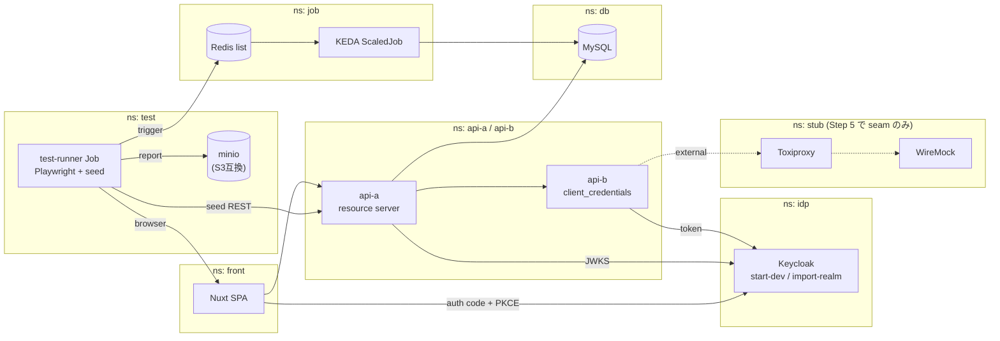

# 構成

## 全体図

実線が PoC の対象、破線が (2) 向けの seam。

## 採用技術

| 要素 | local (PoC) | dev (EKS) |
| --- | --- | --- |
| クラスタ | k3d | EKS (プラットフォームチーム管理) |
| IdP | Keycloak `start-dev --import-realm` / 1 replica / H2 (揮発) | 同じ |
| Ingress | traefik (k3d 標準) | ALB Controller |
| DB | MySQL (in-cluster) | Aurora MySQL |
| Job トリガ | Redis list (KEDA scaler) | SQS / ファイル連携 |
| レポート置き場 | minio | S3 |
| front | Nuxt 4 SPA (SSR off) | 同じ |
| api | Kotlin / Spring Boot 3 resource server | 同じ |

Job トリガを Redis にしたのは、検証したいのが scaler の銘柄ではなく
「テストからトリガを投入して成果物をアサートする型」だから。必要になれば localstack に差し替える。

## 設計の決めごと

### issuer URL の一意性

ブラウザとクラスタ内 Pod の両方から **同一 URL** で Keycloak を解決できること。
詳細と local での解法は [implementation-plan.md](implementation-plan.md) の Step 2 を参照。

### Secret の契約

initContainer は常に `/secrets/*` を読んで realm JSON をレンダリングする。
**`/secrets` の埋め方だけが overlay 差分**になるようにし、local → dev の移植を patch 1枚で済ませる。

- local: ダミーの Secret マニフェスト (Git に入れてよい値のみ)
- dev: 既存実績のある Secrets Manager 注入方式

Keycloak (`idp`) の `/secrets` に置くキー:

| キー | 用途 |
| --- | --- |
| `admin-username` / `admin-password` | master realm の初期管理者 (`KC_BOOTSTRAP_ADMIN_*` に渡す) |
| `user-password-ci` | テストユーザ `ci-01`〜`ci-06` のパスワード |
| `user-password-human` | テストユーザ `human-01`〜`human-04` のパスワード |

realm テンプレート中の `{{secret:<キー>}}` が、`/secrets/<キー>` の内容に置換される。
Keycloak 自身の `${...}` 置換と混ざらないよう、記法を分けている。参照先のファイルが無い場合、initContainer は失敗する。

### run-id の全層伝播

test-runner が run-id を発行し、以下に伝播させる。

- HTTP: `X-Test-Run-Id` ヘッダ
- Redis メッセージ: 属性に含める
- DB: 対象テーブルに列を持つ
- アプリログ: MDC 等に載せる

失敗時の調査コストが桁で変わるため、Step 3 の時点で入れる。

### 外部呼び出しの seam

api-b の外部連携先 URL を env / ConfigMap から差し替え可能にしておく。
(2) を導入するときは `api-b → Toxiproxy → WireMock` の順に挟むだけで済む。
